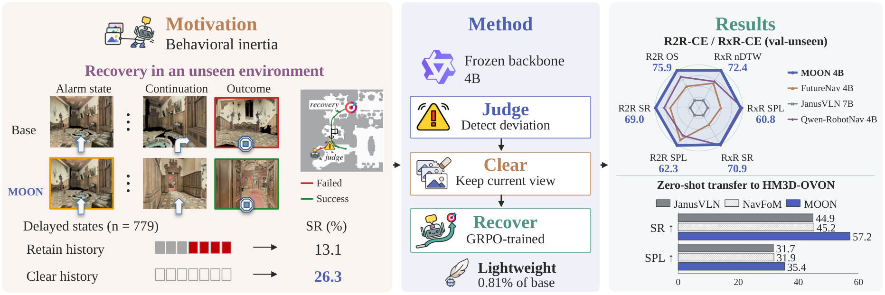
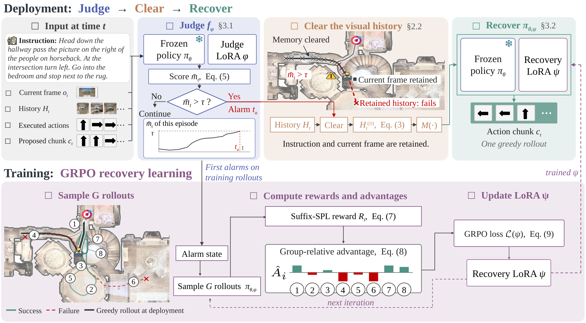

<div align="center">

#  MOON

**Learning When to Forget and How to Move On<br>in Vision-and-Language Navigation**

[](#citation)
[](https://github.com/AutoLab-SAI-SJTU/MOON)
[](https://www.modelscope.cn/models/jmzhou/moon-iclr2027-weights)
[](https://www.modelscope.cn/datasets/jmzhou/moon-iclr2027-data)
[](#training)
[](LICENSE)

</div>

## Overview



MOON learns when to clear visual history and how to recover from a deviation in vision-and-language navigation. A deviation judge monitors a frozen navigation policy. When it detects a deviation, the agent keeps the instruction and current observation, clears its visual history, and switches to a recovery adapter.

The judge and recovery adapter add **36.0M parameters (0.81% of the base)**. MOON improves the base policy's success rate by **5.2 points on R2R-CE** and **6.0 points on English RxR-CE**. The same adapters also transfer to open-vocabulary object navigation without object-goal retraining.

This repository contains inference and evaluation code. The model weights and experiment archive are hosted separately on ModelScope and currently require private access.



Visual history supports route following but can hinder recovery after a deviation. MOON clears history only when the judge triggers recovery. The recovery policy then builds a new history as it moves. The default configuration allows one recovery per episode.

## Code Structure

```text
MOON/
├── moon/
│   ├── inference.py               # MoonAgent API for an RGB stream
│   ├── navida_io.py               # image preprocessing
│   ├── harness/
│   │   ├── host.py                # frozen backbone and adapter loading
│   │   ├── judge.py               # deviation judge
│   │   ├── history.py             # history sampling for the judge
│   │   ├── loop.py                # judge, clearing, and recovery loop
│   │   ├── restart.py             # original instruction and recovery handover
│   │   ├── chunking.py            # action chunks and atomic actions
│   │   └── navida_driver.py       # navigation decoding and visual history
│   └── monitor/
│       └── score.py               # rolling score and calibrated thresholds
├── scripts/
│   ├── check_setup.py             # checkpoint metadata and dependency checks
│   ├── run_harness_eval.py        # Habitat evaluation
│   ├── compare_arms.py            # aggregate and compare evaluation runs
│   ├── build_rxr_en_split.py      # prepare English RxR episodes
│   └── launch/
│       ├── eval.sh                # benchmark and ablation launcher
│       └── configs/eval.env       # evaluation defaults
├── configs/navida/                # English RxR Habitat configuration
├── data/README.md                 # benchmark downloads and directory layout
├── docs/                          # installation, checkpoints, and inference
├── assets/                        # figures and badges
├── tests/                         # CPU tests
└── environment.yml                # Python dependencies
```

## Requirements and Installation

Inference and benchmark evaluation use **Linux, Python 3.10, an NVIDIA GPU, PyTorch 2.7.0 (CUDA 12.6), and Habitat 0.2.4**. FlashAttention requires a compatible CUDA compiler; headless Habitat requires NVIDIA EGL libraries.

```bash
git clone https://github.com/AutoLab-SAI-SJTU/MOON.git
cd MOON
conda env create -f environment.yml
conda activate moon
python -m pip install -e . --no-deps
python -m pip install flash-attn==2.7.4.post1 --no-build-isolation

conda install -c conda-forge -c aihabitat habitat-sim=0.2.4 withbullet headless
git clone --branch v0.2.4 https://github.com/facebookresearch/habitat-lab.git external/habitat-lab
python -m pip install -e external/habitat-lab/habitat-lab -e external/habitat-lab/habitat-baselines
python -m pip install dtw fastdtw
git clone https://github.com/waynechu1021/NAVIDA.git external/NAVIDA
export NAVIDA_ROOT="$(pwd)/external/NAVIDA"
```

See the [installation guide](docs/INSTALL.md) for environment checks and troubleshooting.

## Pre-trained Models and Data

Download the matching base policy and both adapters from [ModelScope weights](https://www.modelscope.cn/models/jmzhou/moon-iclr2027-weights) with an authorized account:

```bash
python -m pip install modelscope
python -c "from getpass import getpass; from modelscope.hub.api import HubApi; HubApi().login(getpass('ModelScope SDK token: '))"
python -c "from modelscope import snapshot_download; snapshot_download('jmzhou/moon-iclr2027-weights', local_dir='checkpoints/moon', allow_patterns=['base_policy/navida_qwen3vl_stage2_v2/*', 'judge_checkpoint-1500/*', 'recovery_iter15/adapter/*'])"
```

Use the SDK token from your [ModelScope account](https://modelscope.cn/my/myaccesstoken). The login command prompts for it without displaying it.

| Checkpoint | Path in the weights repository |
|---|---|
| Frozen NaVIDA-Qwen3-VL base | `base_policy/navida_qwen3vl_stage2_v2/` |
| Deviation judge | `judge_checkpoint-1500/` |
| Recovery adapter | `recovery_iter15/adapter/` |

The base policy is trained on Qwen3-VL-4B-Instruct. Use the trained navigation checkpoint with its matching adapters. Calibration settings are in the [checkpoint guide](docs/CHECKPOINTS.md).

Prepare Matterport3D scenes and R2R-CE / RxR-CE validation episodes using the [data guide](data/README.md). The private [ModelScope data repository](https://www.modelscope.cn/datasets/jmzhou/moon-iclr2027-data) also stores environments and experiment records; the full archive is not needed for inference.

## Quick Start

Run these commands from the repository root after preparing checkpoints and benchmark data. If you downloaded weights elsewhere, change `CHECKPOINT_ROOT`:

```bash
export CHECKPOINT_ROOT="$(pwd)/checkpoints/moon"
export BASE_MODEL="$CHECKPOINT_ROOT/base_policy/navida_qwen3vl_stage2_v2"
export JUDGE_LORA="$CHECKPOINT_ROOT/judge_checkpoint-1500"
export RECOVERY_LORA="$CHECKPOINT_ROOT/recovery_iter15/adapter"

python scripts/check_setup.py \
  --model "$BASE_MODEL" --judge-lora "$JUDGE_LORA" \
  --recovery-lora "$RECOVERY_LORA" --navida-root "$NAVIDA_ROOT"

CUDA_VISIBLE_DEVICES=0 python scripts/run_harness_eval.py \
  --arm c1 --dataset r2r --split val_unseen \
  --model "$BASE_MODEL" --judge-lora "$JUDGE_LORA" \
  --restart-lora "$RECOVERY_LORA" \
  --episodes 1 --out-dir outputs/smoke_r2r \
  --stop-judge-after-budget
```

This evaluates one R2R-CE episode with MOON. The output directory contains `run_config.json`, per-episode metrics in `log/stats_<id>.json`, and decisions in `events/events_<id>.json`. For integration with your own environment, see the [RGB-stream API](docs/INFERENCE.md#rgb-stream-api).

## Evaluation

Evaluate the frozen base, clearing alone, and MOON in sequence:

```bash
DATASET=r2r SHARDS_PER_GPU=1 bash scripts/launch/eval.sh base
DATASET=r2r SHARDS_PER_GPU=1 bash scripts/launch/eval.sh clear_only
DATASET=r2r SHARDS_PER_GPU=1 bash scripts/launch/eval.sh full

DATASET=rxr SHARDS_PER_GPU=1 bash scripts/launch/eval.sh base
DATASET=rxr SHARDS_PER_GPU=1 bash scripts/launch/eval.sh clear_only
DATASET=rxr SHARDS_PER_GPU=1 bash scripts/launch/eval.sh full
```

These commands use one process per visible GPU. The launcher runs recovery on alarmed episodes and combines these outcomes with the remaining base episodes. Results are saved under `outputs/eval_r2r/` and `outputs/eval_rxr/`. See the [evaluation guide](docs/INFERENCE.md) for aggregation, ablations, sharding, resuming, and CPU tests.

## Training

Coming soon after acceptance.

## Results

Paper-reported results on the full **Val-Unseen** splits with a single forward-facing RGB camera. RxR uses English instructions. SR, SPL, and nDTW are reported on a 0–100 scale.

| Method | R2R SR ↑ | R2R SPL ↑ | RxR SR ↑ | RxR SPL ↑ | RxR nDTW ↑ |
|---|---:|---:|---:|---:|---:|
| Frozen NaVIDA-Qwen3-VL base | 63.8 | 59.0 | 64.9 | 55.9 | — |
| Qwen-RobotNav 4B | 66.9 | 60.5 | 71.3 | 61.5 | 68.6 |
| Qwen-RobotNav 8B | 65.7 | 59.6 | 73.4 | 63.5 | 69.9 |
| **MOON** | **69.0** | **62.3** | **70.9** | **60.8** | **72.4** |

Qwen-RobotNav values are the single-camera results from its [technical report](https://arxiv.org/abs/2606.18112).

### Zero-shot Open-Vocabulary Object Navigation

| Method | HM3D-OVON Unseen SR ↑ | SPL ↑ |
|---|---:|---:|
| Frozen base | 40.7 | 21.7 |
| Qwen-RobotNav 4B | 53.1 | 20.9 |
| Qwen-RobotNav 8B | 51.2 | 24.0 |
| **MOON** | **57.2** | **35.4** |

This transfer experiment uses the same adapters and R2R threshold, without object-goal retraining. The current evaluation launcher supports R2R-CE and English RxR-CE; the HM3D-OVON launcher is not included.

## Acknowledgements

MOON builds on [NaVIDA](https://github.com/waynechu1021/NAVIDA), [Qwen3-VL](https://github.com/QwenLM/Qwen3-VL), [Habitat](https://github.com/facebookresearch/habitat-lab), and [VLN-CE](https://github.com/jacobkrantz/VLN-CE).

## License

The code is released under [Apache-2.0](LICENSE). Model weights, benchmark datasets, and upstream code remain subject to their respective licenses and access conditions.

## Citation

The paper link and BibTeX entry will be added with the paper release.
